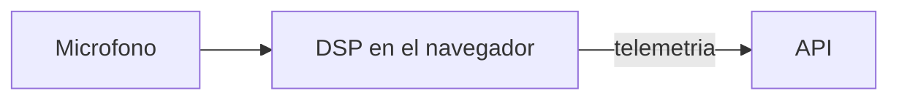

# GuitarCoach Frontend

Aplicación web del tutor de guitarra. El audio del micrófono se procesa en el navegador y no se envía al servidor.

## Cómo ejecutarlo

Requisitos: Node.js 22.

```powershell
npm ci
npm test
npm run build
npm run dev
```

La aplicación de desarrollo queda en `http://localhost:5173`.

```powershell
npm run dev
```

El afinador, la práctica y el informe viven en el navegador. Solo la telemetría y el texto del tutor salen hacia la API (`VITE_API_URL`).



## Experiencia para principiantes

La interfaz está pensada para quien nunca ha tocado: se aprende escuchando e imitando, y cada palabra técnica se puede explicar.

### Navegación

Cuatro secciones (`src/layout/navigation.ts`) reemplazan los siete enlaces anteriores:

| Sección     | Páginas                         | Para qué sirve                    |
| ----------- | ------------------------------- | --------------------------------- |
| Inicio      | Inicio                          | Ruta guiada y guitarra para tocar |
| Aprender    | Curso paso a paso, Diccionario  | Entender antes de tocar           |
| Practicar   | Afinador, Biblioteca, Práctica  | Afinar, elegir y tocar, en orden  |
| Mi progreso | Mis canciones, Informe y logros | Lo propio y cómo vas              |

En escritorio, la barra superior muestra las secciones y una segunda fila, las páginas de la sección abierta. Desde 860 px hacia abajo, las secciones pasan a una barra inferior fija, al alcance del pulgar.

### Ayudas

- **Ruta guiada** (`src/ui/GuidedPath.tsx`): cinco pasos en Inicio (afinar, primer acorde, tocar, subir una canción y revisar el avance). El botón principal siempre lleva al siguiente paso pendiente.
- **Glosario** (`src/domain/glossary.ts`, `src/ui/Term.tsx`): las palabras con subrayado punteado se explican al tocarlas. `GlossaryText` las marca también en los textos del curso. La página `/glosario` reúne todas, con búsqueda.
- **Guitarra interactiva** (`src/ui/GuitarExplorer.tsx`): cada casilla del mástil suena y dice qué nota es; los botones de acordes muestran dónde van los dedos.
- **Logros y racha** (`src/domain/journey.ts`, `src/store/journey.ts`): días seguidos practicando e insignias. Sin sesión viven en `localStorage`. Al entrar se juntan con los de la cuenta (`/me/journey`), que desde ahí manda; al salir se borran de este navegador y vuelven al entrar de nuevo.

### Dónde conseguir archivos de Guitar Pro

Mis canciones enlaza a sitios externos, en `src/domain/tabSources.ts`: [GProTab](https://gprotab.net/), [Ultimate Guitar](https://www.ultimate-guitar.com/explore?type%5B%5D=Pro) y el [Free Rock Pack](https://www.guitar-pro.com/blog/p/11970-free-rock-guitar-pro-pack) oficial. Son páginas de terceros y sus condiciones pueden cambiar; conviene revisar esa lista de vez en cuando.

### Temas

Hay modo claro, oscuro y según el sistema. Cada color de `src/styles.css` declara sus dos valores con `light-dark()`, y el tema solo cambia `color-scheme`. Los diagramas de acordes y la partitura se quedan sobre papel claro en ambos modos para que se lean bien.

## Cómo escucha la app

Todo ocurre en el navegador: el audio no sale de él. `src/audio/listening/guitarListener.ts` recibe las muestras del micrófono con su posición en el reloj de audio, así cada ataque conserva su instante aunque la pantalla se trabe.

1. **Micrófono sin filtros de voz** (`GUITAR_MIC`). La supresión de ruido y el control de ganancia se comen el ataque y el final de cada nota.
2. **Ataques.** Flujo espectral comprimido y umbral que se adapta a lo reciente. Mira cada 12 ms con acordes y cada 6 ms con notas. Soltar las cuerdas también sacude el espectro, pero baja el volumen: eso no cuenta como ataque.
3. **Acordes.** Desde cada ataque se analizan ventanas de 46, 93 y 186 ms mientras no llegue otro; así un cambio rápido se decide con lo que alcanzó a sonar y uno lento gana precisión. Se usan picos del espectro con frecuencia interpolada, se corrige la afinación común de la guitarra y se resta lo que ya sonaba antes del ataque, porque el acorde anterior sigue vibrando.
4. **Notas.** YIN con ventana de 35 ms. Los ligados y slides no tienen ataque: se reconocen porque la altura salta y se queda.
5. **Seguimiento** (`scoreFollower.ts`). Cada ataque cuenta para el tramo más cercano de la carta y las ventanas de un tramo se suman en un solo veredicto. La melodía se sigue en orden, sin importar la octava, y tolera notas saltadas.

### Qué tan rápido entiende

`e2e/listening.spec.ts` toca las muestras reales de guitarra de la app directamente al analizador, con ruido de fondo:

| Prueba                             | Tramo más corto | Resultado        |
| ---------------------------------- | --------------- | ---------------- |
| Acordes a 72, 120, 180 y 240 BPM   | 250 ms          | 12 de 12         |
| Un acorde cada corchea a 240 BPM   | 125 ms          | 11 de 12         |
| Acordes equivocados a 200 BPM      | 300 ms          | 0 de 8 aceptados |
| Melodía en corcheas a 90 y 160 BPM | 188 ms          | 100 %            |
| Melodía en semicorcheas a 200 BPM  | 75 ms           | 85 %             |
| Melodía en semicorcheas a 300 BPM  | 50 ms           | 70 %             |

**Límites.** Estas cifras no pasan por un micrófono ni por una sala: una guitarra real con un micrófono de portátil dará resultados menores. Reconoce un acorde o una nota a la vez; no separa una melodía tocada sobre un acorde. El metrónomo durante el intento se oye en el micrófono, así que va mejor con audífonos.

## Sonido de la guitarra

Los acordes, rasgueos y notas se tocan con muestras reales de guitarra de acero (FluidR3 GM, CC BY 3.0), alojadas en `public/samples/guitar-steel`. Si falta un archivo, se pide al CDN de midi-js-soundfonts. El motor vive en `src/audio/guitar/`:

| Módulo              | Qué hace                                                                                                                                                                  |
| ------------------- | ------------------------------------------------------------------------------------------------------------------------------------------------------------------------- |
| `sampleBank.ts`     | Descarga y decodifica las muestras antes de tocar y salta el silencio que el MP3 deja antes del ataque.                                                                   |
| `strumPerformer.ts` | Convierte un golpe en notas por cuerda: hacia abajo de la sexta a la primera, hacia arriba solo las cuatro agudas, con acentos por tiempo y pequeñas variaciones humanas. |
| `stringVoices.ts`   | Una voz por cuerda. Volver a tocar una cuerda apaga su nota anterior, como en una guitarra real. La intensidad cambia volumen y brillo.                                   |
| `outputChain.ts`    | Resonancia de la caja, una sala corta, compresión y un limitador para que seis cuerdas juntas no saturen.                                                                 |

`src/audio/guitarTone.ts` es la fachada que usan las pantallas. `playPattern` y `playSlots` devuelven los golpes ya alineados con el reloj de audio, para que las flechas del rasgueo se enciendan junto con el sonido.

## Mis canciones: guías de canciones elegidas

En `/canciones` el usuario sube la **tablatura de Guitar Pro** de la canción (`.gp3`, `.gp4`, `.gp5`, `.gpx` o `.gp`, de Guitar Pro 3 en adelante) y la app arma su guía de estudio (ver "Tablaturas" más abajo). Ya no se pegan acordes ni se analizan audios: un cifrado o una grabación no dicen qué tocó la guitarra, y la tablatura sí.

`/canciones/:id` abre la guía:

- Reproductor por sección o de la canción entera, con velocidad del 50 al 100 %, cuenta de entrada, metrónomo, repetición y melodía si el archivo la trae. Cada sección suena con su propio rasgueo. La melodía va más fuerte que el rasgueo y en otro lado del estéreo, como una segunda guitarra.
- **Melodía o guía armónica**: un cifrado no trae las notas de la canción. Cuando no hay notas escritas, la app ofrece una _guía armónica_ (la fundamental y la tercera de cada acorde). La marca con ese nombre y la deja apagada para que nadie la confunda con la melodía real. `hasWrittenMelody` también la reconoce en las guías que se guardaron antes de este cambio.
- **Cejilla**: las notas escritas ya están en la altura que suena. Solo la guía armónica, que sale de las formas de los acordes, sube con la cejilla (`soundingMelody`).
- La carta resalta el compás que suena, y el panel muestra el acorde actual y el siguiente.
- **Corregir la guía**: cada sección se edita como `| G | D . C . |` (un tramo por compás, el punto prolonga el acorde) con un rasgueo `D-DU-UDU`. Al guardar se puede marcar como revisada.
- **Practicar con el micrófono**: abre la práctica con la canción de la guía y su rasgueo; el intento queda para el informe.

La lógica pura vive en `src/domain/guide.ts` (golpes por sección, notación de compases y rasgueo, edición de secciones) y el audio en `playGuide` de `src/audio/guitarTone.ts`. El clic del metrónomo (`src/audio/guitar/metronome.ts`) no pasa por la reverberación, para sonar seco.

## Tablaturas: la canción nota por nota

Un cifrado dice qué acorde va, pero no qué notas tocó el guitarrista. Para que el alumno oiga la canción tal como es, en **Mis canciones** se sube la tablatura del cover. Queda guardada como una canción más, y su guía la toca con [alphaTab](https://alphatab.net) (MPL-2.0).

**Al subirla**

1. El navegador lee el archivo con alphaTab y se queda **solo con la guitarra**. La pista se elige por su nombre y, si no lo dice, por tener seis cuerdas. Guitar Pro da seis cuerdas también a la voz, así que una pista llamada voz, bajo, ukelele o batería se descarta. Con esa pista arma la guía (`src/tab/scoreToGuide.ts`):
   - **Rasgueos**: cada golpe de dos cuerdas o más es un rasgueo, con su hueco real hasta el siguiente.
     - **Dirección**: la de la flecha del archivo (púa o barrido). Sin flecha, la mano va y viene: abajo en las casillas pares de la rejilla y arriba en las impares, en corcheas o en semicorcheas si el compás las usa. Con el Riptide de prueba esta regla coincide con todas las flechas escritas.
     - **Tipos de golpe**: un golpe con todas las notas muertas es un chuck. Un silencio o una nota ligada es aire, que deja sonar el acorde.
     - **Dinámica**: la del archivo (de _ppp_ a _fff_).
   - **Acordes**: los que escribe la tablatura; si no trae, se deducen de las notas de cada compás. Con cejilla se nombra la forma que pisa la mano (Am con cejilla 1, no Bbm) y la guía guarda la cejilla.
   - **Notas punteadas**: los golpes de una sola nota (riffs, intros, solos) son la melodía, en la altura que suena. Un rasgueo no es melodía.
   - **Estructura**: secciones (las marcas del archivo, o partes de ocho compases) y el mapa de tempo.
2. La API valida esa guía con el mismo esquema que una corrección, reconoce el formato del archivo por su firma y guarda los dos (`POST /guides/from-tab`). Subir lo mismo otra vez devuelve la misma guía.

**En la guía**

Dos vistas, con un selector arriba:

- **Acordes y rasgueo** (por defecto): el reproductor de la guía toca los acordes con el rasgueo detectado. El panel enseña un compás del patrón de la sección; con "Toda la canción" empieza en la primera sección donde toca la guitarra, porque una intro de otro instrumento no enseña nada. Debajo van la carta, la práctica con micrófono y el informe.
- **Partitura**: la tablatura con el botón "Escuchar la guitarra". Suena solo la guitarra (las demás pistas quedan en silencio), con las notas del archivo y sus técnicas (ligados, bends, slides, palm mute), a través del soundfont General MIDI Sonivox (Apache 2.0) que viene con alphaTab. El cursor sigue cada nota: un clic empieza desde esa nota y arrastrar repite ese tramo. Hay velocidad del 50 al 100 %, cuenta de entrada, metrónomo y repetición. Si el archivo trae varias guitarras, se elige cuál.

| Módulo                    | Qué hace                                                                                                   |
| ------------------------- | ---------------------------------------------------------------------------------------------------------- |
| `src/tab/tabFile.ts`      | Lógica pura: valida que sea Guitar Pro, elige la pista de guitarra y formatea el reloj.                    |
| `src/tab/scoreToGuide.ts` | Convierte la guitarra de la partitura en la guía: rasgueos, acordes, notas punteadas, secciones y tempo.   |
| `src/tab/readTab.ts`      | Lee el archivo subido. Descarga alphaTab solo la primera vez que alguien sube una tablatura.               |
| `src/tab/useAlphaTab.ts`  | Hook que monta alphaTab, escucha sus eventos (partitura, reproductor, posición) y expone los controles.    |
| `src/ui/TabPlayer.tsx`    | El reproductor dentro de la guía. Se carga bajo demanda: el resto de la app no descarga alphaTab (318 KB). |

El plugin `@coderline/alphatab-vite` (en `vite.config.ts`) copia las fuentes de notación a `/font` y el soundfont a `/soundfont`, y prepara el worker y el worklet de audio. En desarrollo, `vite.config.ts` hace esa copia antes de que arranque el servidor, porque Vite solo sirve lo que ya estaba en `public/` al iniciar. Al abrir la tablatura, la guitarra de las guías se calla para que los dos motores no se pisen.

**Formato de la API.** La app trabaja el tempo como `usPerQuarter` y la API lo valida como `us_per_quarter`. `guideToWire` (`src/api/guides.ts`) hace esa conversión al guardar. Antes faltaba, y corregir una guía respondía 422.

## Pruebas

- `npm test`: pruebas unitarias con Vitest (motor de audio, reconocimiento de acordes, guías, afinador y pantallas).
- `npm run e2e:live`: recorrido completo contra la API real, con un micrófono simulado que toca un acorde. Necesita `uvicorn` en el puerto 8000 con `CORS_ORIGINS` que incluya `http://localhost:4173`.
- `npm run e2e`: pruebas de navegador con Playwright. La API se simula en `e2e/support/mockApi.ts`, así que no hace falta levantar el backend ni la base. La primera vez instala el navegador con `npx playwright install chromium`.

## Despliegue

La imagen escucha en el puerto 8080 y nginx envía COOP y COEP. El despliegue a Cloud Run es el workflow manual `desplegar`. La versión 1.0.0 está en `CHANGELOG.md`.
