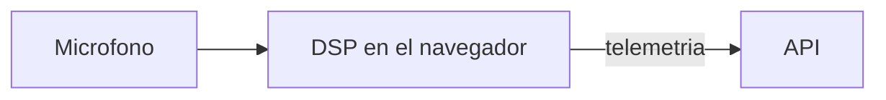

# GuitarCoach Frontend

Aplicación web del tutor de guitarra. El audio del micrófono se procesa en el navegador y no se envía al servidor.

## Cómo ejecutarlo

Requisitos: Node.js 22.

```powershell
npm ci
npm test
npm run build
npm run dev
```

La aplicación de desarrollo queda en `http://localhost:5173`.

```powershell
npm run dev
```

El afinador, la práctica y el informe viven en el navegador. Solo la telemetría y el texto del tutor salen hacia la API (`VITE_API_URL`).



## Sonido de la guitarra

Los acordes, rasgueos y notas se tocan con muestras reales de guitarra de acero (FluidR3 GM, CC BY 3.0), alojadas en `public/samples/guitar-steel`. Si falta un archivo, se pide al CDN de midi-js-soundfonts. El motor vive en `src/audio/guitar/`:

| Módulo              | Qué hace                                                                                                                                                                  |
| ------------------- | ------------------------------------------------------------------------------------------------------------------------------------------------------------------------- |
| `sampleBank.ts`     | Descarga y decodifica las muestras antes de tocar y salta el silencio que el MP3 deja antes del ataque.                                                                   |
| `strumPerformer.ts` | Convierte un golpe en notas por cuerda: hacia abajo de la sexta a la primera, hacia arriba solo las cuatro agudas, con acentos por tiempo y pequeñas variaciones humanas. |
| `stringVoices.ts`   | Una voz por cuerda. Volver a tocar una cuerda apaga su nota anterior, como en una guitarra real. La intensidad cambia volumen y brillo.                                   |
| `outputChain.ts`    | Resonancia de la caja, una sala corta, compresión y un limitador para que seis cuerdas juntas no saturen.                                                                 |

`src/audio/guitarTone.ts` es la fachada que usan las pantallas. `playPattern` y `playSlots` devuelven los golpes ya alineados con el reloj de audio, para que las flechas del rasgueo se enciendan junto con el sonido.

## Despliegue

La imagen escucha en el puerto 8080 y nginx envía COOP y COEP. El despliegue a Cloud Run es el workflow manual `desplegar`. La versión 1.0.0 está en `CHANGELOG.md`.
