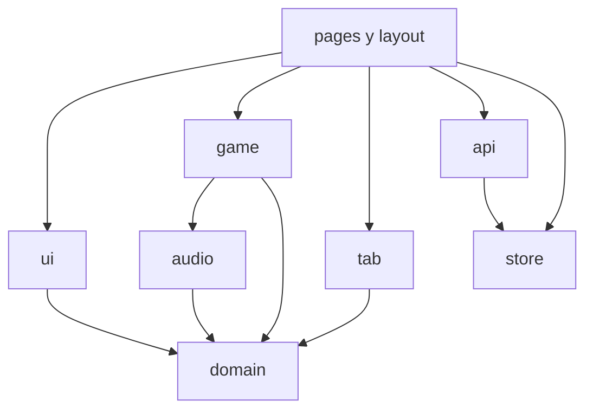

# Arquitectura del cliente

La aplicación es una SPA de React 18, Vite y TypeScript. El micrófono, el afinador, el reconocimiento y la partitura ocurren en el navegador. Al servidor solo salen la cuenta, la telemetría ya juzgada, las guías y el texto del tutor.

## Capas

```text
src/
  pages/         Pantallas. Arman la página y llaman a las demás capas.
  layout/        Cascarón y las cuatro secciones de navegación.
  ui/            Componentes que se pintan: mástil, carta, glosario, partitura.
  domain/        Reglas puras: guía, curso, ruta, glosario, tipos. Sin React y sin red.
  audio/         Micrófono, DSP, guitarra muestreada y metrónomo. Sin red.
  tab/           Guitar Pro y alphaTab. Convierte la partitura en una guía.
  api/           Cliente HTTP. El único sitio que conoce las rutas del backend.
  store/         Sesión, ruta local y el último día visitado.
  auth/          Entrar y crear cuenta, encima del cliente.
  game/          Bucle de la práctica y el veredicto de cada acorde.
  theme/         Claro, oscuro o el del sistema.
```



`domain` no importa React, el cliente ni el audio. Una regla de la guía o del curso se puede probar con Vitest sin levantar el navegador. `audio` no llama a la API: si el reconocimiento se equivoca, el fallo se queda en la máquina del alumno y la telemetría que sí se envía es el veredicto, no las muestras.

## Recorrido de una práctica

```mermaid
sequenceDiagram
  participant M as Micrófono
  participant A as audio/listening
  participant G as game
  participant P as PracticePage
  participant API as ApiClient
  M->>A: muestras con su instante
  A->>G: ataque y acorde o nota
  G->>P: acierto, fallo, desfase
  P->>API: POST /attempts
  API-->>P: id y precisión
```



`guitarListener.ts` marca cada muestra con el reloj de audio, así un tirón de la pantalla no mueve el instante del ataque. `scoreFollower.ts` asigna ese ataque al tramo más cercano de la carta. El detalle de ventanas, umbrales y los resultados medidos está en el README, sección «Cómo escucha la app».

## Sesión y ruta

`store/session.ts` guarda el JWT. El cliente lo manda en `Authorization`. Un 401 con token presente cierra la sesión y la pantalla dice que venció.

La ruta del principiante vive en `localStorage` mientras no hay cuenta. Al entrar, `store/journey.ts` la junta con `POST /me/journey`. Desde ese momento manda el servidor. Al salir se borra de este navegador y vuelve a bajar al entrar.

## Tablatura

Subir un archivo pasa por tres pasos, todos en el cliente menos el último:

1. `tab/tabFile.ts` comprueba que sea Guitar Pro y elige la pista de guitarra.
2. `tab/scoreToGuide.ts` la convierte en secciones, rasgueos, acordes y notas punteadas.
3. `ApiClient.guideFromTab` envía el archivo y esa guía a `POST /guides/from-tab`.

alphaTab se descarga la primera vez que hace falta (`readTab.ts`, `useAlphaTab.ts`, `ui/TabPlayer.tsx`). El resto de la aplicación no arrastra esos 318 KB. `guideToWire` traduce `usPerQuarter` a `us_per_quarter`, que es lo que valida la API.

## Cliente HTTP

`VITE_API_URL` se escribe en el JavaScript al construir. El cliente le quita la barra final: `https://…vercel.app/` más `/auth/login` sería `//auth/login`, y Vercel responde un redireccionamiento sin CORS. El navegador lo vería como «No se pudo entrar».

Si el WebSocket de un trabajo de importación falla, `watchJob` consulta `GET /jobs/{id}` cada segundo y medio. En Vercel ese es el camino normal.

## Aislamiento del origen

`vercel.json` y `nginx.conf` envían `Cross-Origin-Opener-Policy: same-origin` y `Cross-Origin-Embedder-Policy: require-corp`. El audio y la partitura corren en ese origen aislado. La API tiene que responder `Cross-Origin-Resource-Policy: cross-origin` y aceptar este origen en `CORS_ORIGINS`. Sin esas dos cosas el navegador descarta la respuesta y la pantalla muestra un fallo de red, no el mensaje de la API.

## Rutas

| Ruta                  | Pantalla                      | Sección     |
| --------------------- | ----------------------------- | ----------- |
| `/`                   | Inicio, ruta guiada           | Inicio      |
| `/aprendizaje`        | Curso                         | Aprender    |
| `/glosario`           | Diccionario                   | Aprender    |
| `/afinador`           | Afinador                      | Practicar   |
| `/biblioteca`         | Catálogo                      | Practicar   |
| `/practica`           | Práctica con micrófono        | Practicar   |
| `/canciones`          | Guías propias                 | Mi progreso |
| `/canciones/:guideId` | Una guía                      | Mi progreso |
| `/informe`            | Informe y logros              | Mi progreso |
| `/entrar`             | Iniciar sesión o crear cuenta | —           |

`/registro` redirige a `/entrar?alta=1`. La definición de las cuatro secciones está en `src/layout/navigation.ts`.
